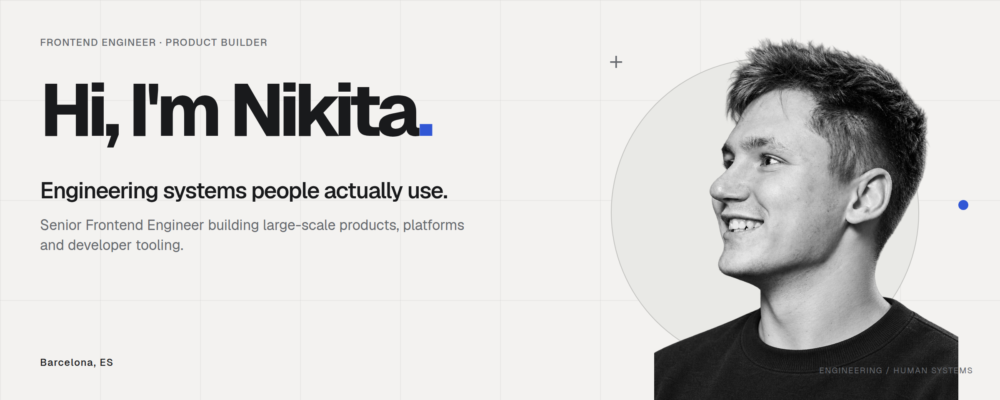

<!-- brand-studio:start -->
<picture>
  <source media="(prefers-color-scheme: dark)" srcset="./assets/profile/hero-dark.png" />
  <source media="(prefers-color-scheme: light)" srcset="./assets/profile/hero-light.png" />
  
</picture>

[Website](<https://nikitapogorelov.com>) · [LinkedIn](<https://www.linkedin.com/in/nikita-pogorelov/>) · [GitHub](<https://github.com/nikitapogorelov>)
<!-- brand-studio:end -->

 

### BEYOND THE INTERFACE

**I build user-facing products and the systems behind them.**

I'm a software engineer working at the intersection of **product engineering**, **frontend architecture**, and **developer experience**. I care about the details users notice — and the tools, foundations, and workflows that make great engineering possible.

---

### SELECTED WORK

**Yandex Search**  
Worked on high-traffic search interfaces with React and TypeScript, focusing on performance, experimentation, and reliable product delivery.

**X5 Tech**  
Built frontend experiences for a B2B logistics platform serving around 10,000 users, with an emphasis on maintainable architecture and product usability.

**Developer platforms**  
Built end-to-end testing infrastructure and development-mocking tools adopted by 100+ engineers, making it easier to develop, test, and ship.

---

### WHAT I WORK WITH

**Product & frontend** — TypeScript · React · Next.js · Web Performance  
**Engineering foundations** — Playwright · CI/CD · Design Systems · Developer Tooling  
**Beyond the browser** — Go · Docker · Kubernetes · Infrastructure

---

### WHAT MATTERS TO ME

Thoughtful interfaces. Systems that scale. Fast feedback loops. Architecture that makes change easier — not harder.

I also like exploring new ideas beyond day-to-day product work, from full-stack tools to creative projects with Unreal Engine.

**[Explore my work and projects →](https://nikitapogorelov.com)**
